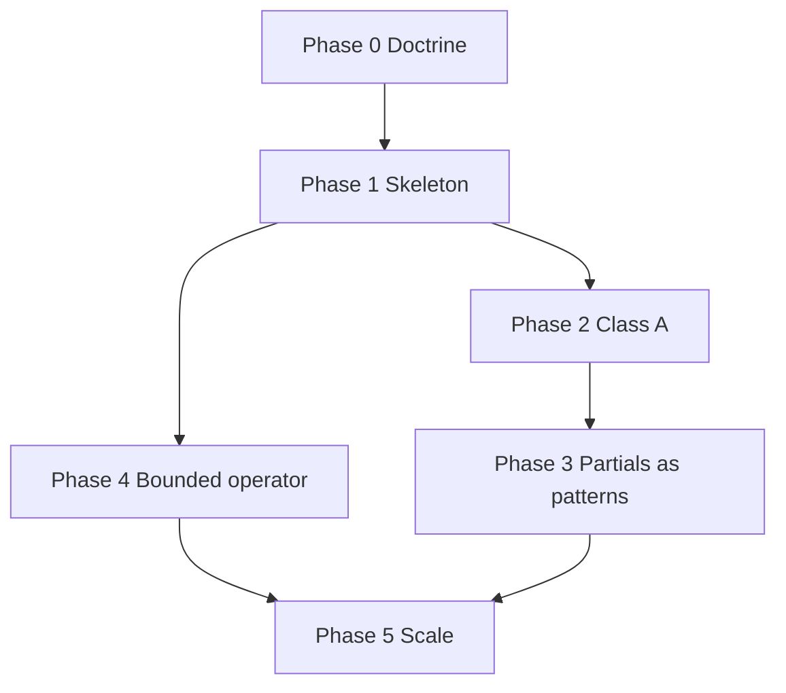

# Atria convergence + autonomy program plan

<!--
Status: Operating board (execution plan, not product redesign)
Last updated: 2026-04-03
Companion: ATRIA_SYSTEM_CHARTER.md, TRUTH_CONVERGENCE.md, GLOBAL_PHILOSOPHY_INTEGRATION_MATRIX.md, global_philosophy_integration_matrix.json, AUTONOMOUS_REPAIR_POLICY.md, convergence_program_state.json
-->

## Current program state (human mirror)

**Automation reads program state only from [`convergence_program_state.json`](convergence_program_state.json).** Update that file first, then sync this section so humans and tools stay aligned.

| Field | Value |
|-------|-------|
| **Active phase** | **2** — Class A convergence |
| **Operating loop** | enforcement → confirmed violations → bounded fix → rerun → converge |
| **Updated** | 2026-04-03 |

**Active objectives (max 3):**

| ID | Title | Track |
|----|-------|-------|
| 2A | Trace-or-exempt | A — Law enforcement |
| 2C | Canonical identity | B — Class A convergence |
| 2B | Product honesty | B — Class A convergence |

**Blocked:** *(none)*

**Notes:** runner signal quality: good

*Update this mirror when you change `convergence_program_state.json`; do not rely on Markdown formatting for tooling.*

---

## 1. Program purpose

**Stop re-litigating philosophy in every implementation thread** and **stop manual one-off fixes** from substituting for law.

This program coordinates:

- **Convergence** — Class A/B philosophies become **inspectable**, **checkable**, and **as-built aligned** where the charter demands it.
- **Autonomy (bounded)** — A **runner + checkers + optional repair** loop improves drift signal and can apply **small, reversible, checker-backed** fixes—not product redesign.

**In scope:** enforcement skeleton, burn-down of highest-cost drift, explicit boundaries for partial philosophies, git-disciplined automation.

**Out of scope:** redesigning product features, ontology debates, or expanding repair to heuristic-only findings.

---

## 2. Phase plan (0–5)

| Phase | Name | Goal |
|-------|------|------|
| **0** | Lock the operating doctrine | Charter + truth convergence + matrix + repair policy so every major philosophy has one-sentence law, scope, class A/B/C, enforcement type. |
| **1** | Build the enforcement skeleton | Philosophy runner, checker registry, md/json reports, strict mode, CI workflow, auto-repair skeleton + repair registry, git checkpoint/revert spine. |
| **2** | Burn down Class A drift | Trace-or-exempt, product honesty, canonical identity enforcement, deterministic commit law—**globally real** where classified **A** (and critical **B** where tied to A). |
| **3** | Declare partial philosophies as system patterns | Mirror interpretation envelope, data access policy, execution seam—each surface **on the contract** or **explicitly not**. |
| **4** | Bounded operator | Enable first safe repair handlers, handler library, structured commits + checkpoints—**reversible** mutations only. |
| **5** | Scale propagation | More checkers/repairs, nightly/trend reports, ledger/issue surfacing for non-repairable confirmed violations. |

---

## 3. Parallel work tracks

| Track | Focus |
|-------|--------|
| **A — Law enforcement** | Runner, checkers, CI, auto-repair policy alignment with charter/matrix. |
| **B — Class A convergence** | Trace coverage, canonical identity, product honesty, commit law. |
| **C — Structural unification** | Interpretation envelope scope, execution seam inventory, policy boundaries (data access / egress). |
| **D — Autonomy** | Repair handlers, git checkpoints, safe mutation, report generation. |

Tracks **B** and **A** run together once Phase 1 exists; **C** proceeds in parallel where it does not block **B**; **D** follows confirmed checker + repair registry entries.

---

## 4. Priority order

**Immediate**

1. Finish **Class A** burn-down (especially trace + honesty + identity + commit).
2. Enable **first safe repair handler** (deterministic, bounded, checker-backed, report-only default).
3. Define **branch + checkpoint** workflow per `AUTONOMOUS_REPAIR_POLICY.md`.
4. Expand **checker coverage** for highest-cost drift (confirmed paths first).

**Next**

5. Formalize **envelope / policy / seam** scope (Phase 3 exit: no vague north stars).
6. Classify remaining **partial** integrations in the matrix (B with boundary vs C parked).
7. Automate **surfacing** of non-repairable confirmed violations (ledger/issue stub).

**Later**

8. Nightly operator loop, PR automation, broader repair classes—only after signal quality is stable.

---

## 5. Dependencies between phases

- **Phase 2** depends on **Phase 1** (runner + categorization of violations).
- **Phase 4** depends on **Phase 1** (registry + policy + git spine); may start in parallel with **Phase 2** for **report-only** repair.
- **Phase 3** depends on **Phase 2** being far enough along that Class A fires are not masking structural ambiguity.
- **Phase 5** depends on **Phase 4** (at least one closed loop) and stable **Phase 1** reporting.

---

## 6. Exit criteria by phase

### Phase 0 — Doctrine

- Every major philosophy in **`GLOBAL_PHILOSOPHY_INTEGRATION_MATRIX.md`** has: **one-sentence law**, **scope**, **class A/B/C**, **enforcement type**.
- No major ambiguity on: **truth ownership**, **canonical identity**, **trace law**, **product honesty**, **deterministic commit**—as recorded in **`ATRIA_SYSTEM_CHARTER.md`** and **`TRUTH_CONVERGENCE.md`**.

### Phase 1 — Skeleton

- Runner works **locally** and in **CI**.
- Violations categorized: **confirmed** / **heuristic** / **not-yet-automated**.
- Auto-repair can run **report-only** without mutation risk.
- Repair registry + policy describe **allowed** repair kinds.

### Phase 2 — Class A burn-down

- **2A Trace-or-exempt:** No **confirmed** silent AI paths; partial coverage only with **approved** exempt registry entries; coverage map maintained.
- **2B Product honesty:** No false **runtime** claims; parked/planned clearly marked; studio/operator exceptions **bounded** in matrix/charter.
- **2C Canonical identity:** No **confirmed** leaks in authenticated “user” flows; legacy rows **not** equal centers **by default**; user weighting remains a **separate axis** (charter-aligned).
- **2D Deterministic commit:** No known **silent** fallback writes on confirmed commit; core commit laws have **checker** coverage where feasible.

### Phase 3 — Partials as patterns

- **3A Mirror envelope:** Each surface **adopts**, **defers locally**, or **not applicable**—documented; no orphan “north star.”
- **3B Data access:** Qualifying paths through **policy** or **documented exception**; no silent bypass in covered scope.
- **3C Execution seam:** Critical paths **seam-routed**; remaining bypasses **listed**, not accidental.

### Phase 4 — Bounded operator

- At least one checker: **detect → repair (optional) → rerun → report** with **git checkpoint** and **revert** on failure.
- **≥ 3** stable handlers or clear stubs in **`scripts/philosophy_enforcement/repairs/`** with registry-defined scope.

### Phase 5 — Scale

- Trend reports across runs; non-repairable **confirmed** items surface to ledger/issues automatically where configured.
- Human invoked for: **policy change**, **ambiguous architecture**, **failed bounded repair** only.

---

## 7. Current status by phase

| Phase | Status (as of last update) |
|-------|----------------------------|
| **0** | **Mostly done** — charter, truth convergence, matrix (md+json), autonomous repair policy exist; minor row updates may follow identity/trace work. |
| **1** | **Done enough to move forward** — `scripts/philosophy_enforcement/` runner, registry, reports, CI hook path per policy; tighten strict mode + coverage over time. |
| **2** | **In progress** — trace/honesty/commit/identity each have partial tooling and some fixes; **complete burn-down not finished** (e.g. placement/node-transform canonical defaults, trace gaps per matrix). |
| **3** | **Partial / documentation-heavy** — envelope, policy, seam: boundaries exist in docs; **unified enforcement** not complete. |
| **4** | **Early** — policy + registry exist; **first closed-loop unattended repair** not yet the default outcome. |
| **5** | **Not started** as a sustained loop. |

---

## 8. Top 10 active objectives

**Execution discipline:** At most **three** concurrent objectives are tracked in **`convergence_program_state.json`** (see [Current program state](#current-program-state-human-mirror)). The numbered list below is **backlog**—prioritize work using the JSON state and **confirmed** runner violations, not this list alone.

1. **Close confirmed trace gaps** — Complete server/client coverage map; align with `AI_ACTION_SUBSTRATE_COVERAGE_MATRIX.md` + `charter_enforcement_check.py`.
2. **Exempt registry discipline** — Every exempt id has **scope**; no “silent AI” without exempt or trace.
3. **Product honesty sweep** — Stub labels, dead routes, Tier A vs deeper tiers: **runtime-aligned** or **explicitly parked** in `TRUTH_CONVERGENCE.md` / `ACTIVE_VS_PLANNED.md`.
4. **Canonical identity — server** — Authenticated paths that mean “user” default to **canonical core** when `profile_id` / `active_profile` absent (e.g. placement, node-transform); align with charter §1.5.
5. **Canonical identity — client** — Consume **`is_canonical`** where it reduces drift vs ad hoc `is_primary`/`[0]` logic; keep user weighting separate.
6. **Legacy peering** — No **new** behaviors that treat legacy core rows as equal centers without explicit admin/opt-in (influences/graph already partially addressed).
7. **Deterministic commit audit** — All confirmed write paths: explicit payload, schema-grounded fields, honest failure; extend charter script/checkers.
8. **First repair handler** — One **deterministic** repair (e.g. trace marker stub, dead doc reference, narrow constant) with **report-only** default and **checkpoint/revert**.
9. **Phase 3 scope statements** — One paragraph each: mirror envelope **mandatory vs local**, data access **mandatory call sites**, seam **critical path list**.
10. **Matrix maintenance** — After each Class A fix, update **matrix row** + **json** so automation and humans share one truth.

---

## 9. What not to do

- Do **not** mix **ontology redesign** with **repair automation**.
- Do **not** auto-fix **heuristic-only** findings.
- Do **not** grow checker count faster than **signal quality** (avoid noisy CI).
- Do **not** let **not-yet-automated** become a permanent graveyard—time-bound or reclassify to **C parked**.
- Do **not** evolve docs **without** updating charter, matrix, json registry, or repair registry when the change is **law or scope**.

---

## 10. Governance rule (philosophy changes)

**Every philosophy or scope change** must either:

1. Update **`ATRIA_SYSTEM_CHARTER.md`** and **`GLOBAL_PHILOSOPHY_INTEGRATION_MATRIX.md`** (+ **`global_philosophy_integration_matrix.json`**) and, when product truth shifts, **`TRUTH_CONVERGENCE.md`**; **or**
2. **Explicitly record** in the same PR **why not** (e.g. typo-only, pointer-only), with a **follow-up issue** if the drift is temporary.

**Repair automation** may not change charter/matrix semantics unless **human-authored** in the same change set per **`AUTONOMOUS_REPAIR_POLICY.md`**.

---

## Related documents

| Document | Role |
|----------|------|
| `ATRIA_SYSTEM_CHARTER.md` | Enforceable laws |
| `TRUTH_CONVERGENCE.md` | Locked product/API truth |
| `GLOBAL_PHILOSOPHY_INTEGRATION_MATRIX.md` | Human-readable convergence map |
| `global_philosophy_integration_matrix.json` | Machine-readable registry for runner |
| `AUTONOMOUS_REPAIR_POLICY.md` | Bounds for auto-repair + git discipline |
| `ACTIVE_VS_PLANNED.md` | As-built vs planned |
| `ATRIA_CHARTER_VIOLATION_LEDGER.md` | Known violations + remediation |
| `convergence_program_state.json` | Machine-readable active phase / objectives / loop (runner reads **only** this for program state) |
| `scripts/philosophy_enforcement/` | Runner, checkers, reports, repair entrypoints |

---

## Stop conditions (when to “let go more”)

Proceed to heavier automation and less manual relay when:

- Class A philosophies are **mostly green** in runner output (confirmed bucket).
- Runner **reliably** catches real drift (low false-positive rate).
- At least **one** closed-loop **repair** path works **unattended** with **checkpoint/revert**.
- Remaining partials are **explicitly bounded** in the matrix—not accidental gaps.

Until then, **program-level movement** still beats **one microscopic fix at a time**, but **human gate** stays on policy and ambiguous architecture.
